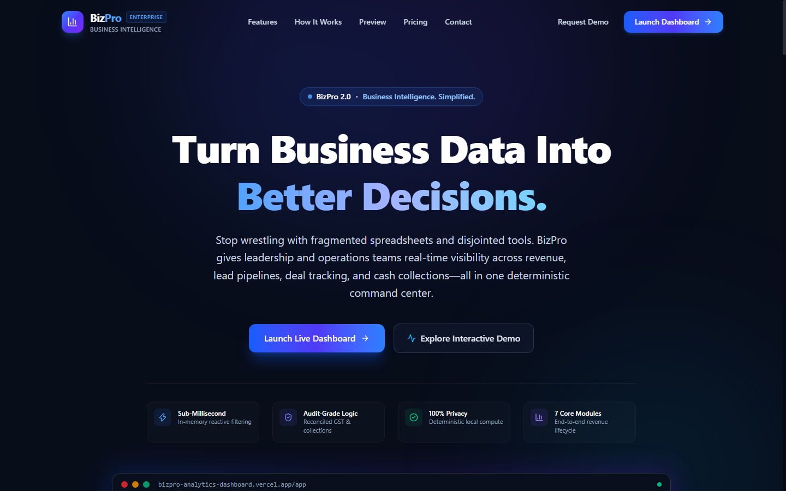
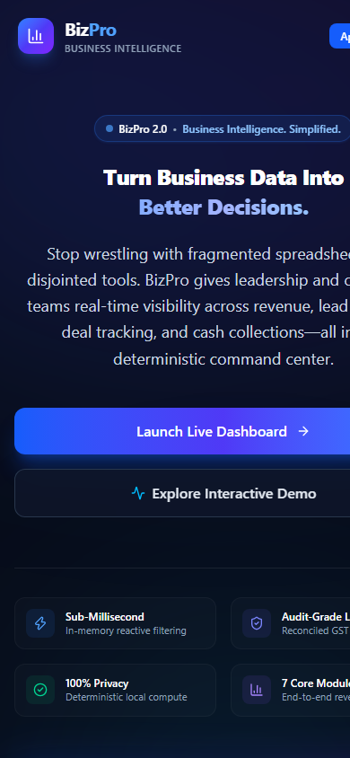
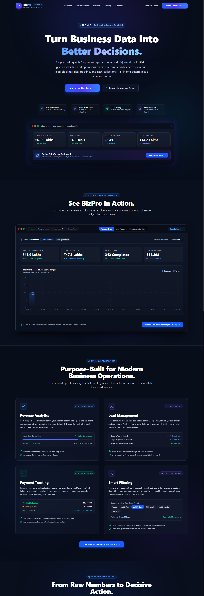
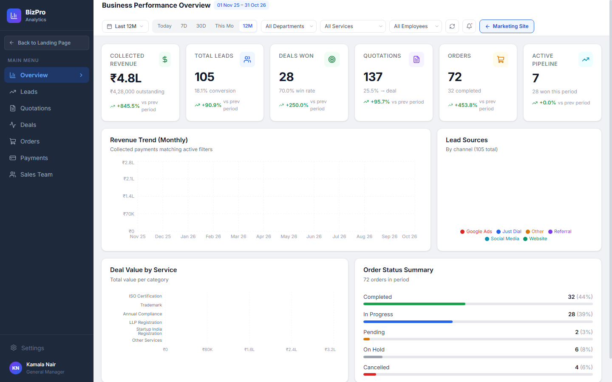
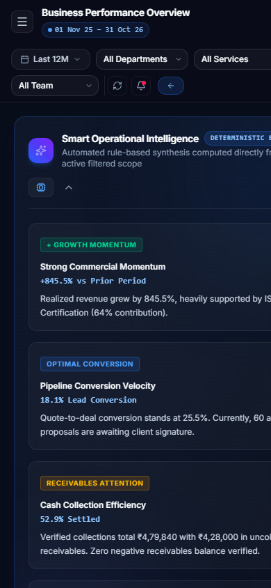
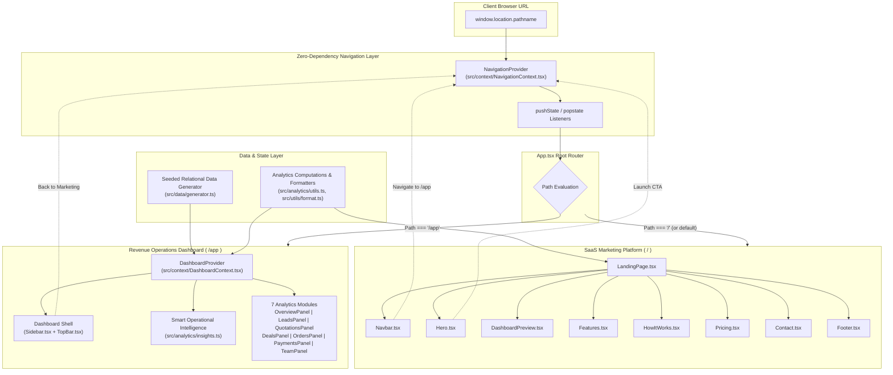

# BizPro Premium
### Business Intelligence. Simplified.

[](https://bizpro-analytics-dashboard.vercel.app/)
[](https://react.dev/)
[](https://www.typescriptlang.org/)
[](https://vitejs.dev/)
[](https://tailwindcss.com/)
[](https://recharts.org/)
[](LICENSE)

A modern, responsive SaaS business intelligence platform combining an interactive marketing website with a comprehensive revenue operations dashboard.

BizPro delivers a seamless **dual-experience architecture**:
- **`/` — Premium SaaS Marketing Website**: Conversion-focused marketing interface featuring high-contrast product storytelling, interactive Recharts preview frames, structured value pillars, illustrative pricing, and a validated lead acquisition flow.
- **`/app` — Interactive Business Analytics Dashboard**: Enterprise command center with 7 operational analytics panels, 9 dynamic date presets, multi-dimensional filters, period-over-period financial benchmarks, and deterministic rule-based operational intelligence.

---

## 🌐 Live Deployments

| Resource | Direct Link | Description |
|---|---|---|
| 🚀 **Live SaaS Website** | [https://bizpro-analytics-dashboard.vercel.app/](https://bizpro-analytics-dashboard.vercel.app/) | Marketing landing page with interactive previews and contact flow |
| 📊 **Live Analytics Dashboard** | [https://bizpro-analytics-dashboard.vercel.app/app](https://bizpro-analytics-dashboard.vercel.app/app) | Full enterprise analytics command center (7 operational modules) |
| 💻 **GitHub Repository** | [https://github.com/mayanksinha17/bizpro-analytics-dashboard](https://github.com/mayanksinha17/bizpro-analytics-dashboard) | Source code, configuration, and documentation |

---

## 📸 Screenshot Showcase

### Desktop Landing Page (1440px)
High-contrast hero section with floating KPI metric cards, primary & secondary conversion triggers, and interactive product preview.



---

### Mobile Landing Page (390px)
Touch-optimized viewport layout with fluid responsive typography, accessible navigation drawer, and vertically stacked feature cards.



---

### Full Website Preview
Comprehensive end-to-end product narrative: Navigation, Hero, Live Dashboard Preview, 4 Feature Pillars, 3-Step Workflow, Pricing, Validated Contact Form, and Footer.



---

### Executive Analytics Dashboard (`/app`)
Enterprise dark-mode command center featuring the Smart Operational Intelligence banner, global multi-filter controls, KPI cards, and Recharts financial visualizations.



---

### Mobile Dashboard Experience (390px)
Responsive analytics layout with adaptive horizontal filter scrolling, full-width KPI metric cards, and responsive chart viewports.



---

## ✨ Key Features

### 1. SaaS Marketing Website (`/`)
* **Responsive Navigation**: Sticky glassmorphic navbar with BizPro branding, section jump links (`Features`, `How It Works`, `Preview`, `Pricing`, `Contact`), quick `Launch Dashboard` action button, and a mobile sliding drawer with keyboard `Escape` dismiss.
* **Interactive Hero Section**: Value proposition headline (*"Turn Business Data Into Better Decisions"*), product positioning (*"BizPro — Business Intelligence. Simplified."*), dual conversion CTAs, floating live KPI cards, and architectural proof badges highlighting in-memory reactive filtering, reconciled GST and collections logic, client-side data privacy, and 7 core operational modules.
* **Interactive Dashboard Preview**: Mac-inspired application frame showcasing live interactive Recharts visualizations with 3 selectable operational views:
  * *Revenue Trend*: Monthly target vs. realized revenue progression.
  * *Lead Funnel*: 3-tier conversion progression (Inquiries → Proposals → Retainers).
  * *Collections & Services*: Settlement integrity and departmental revenue distributions.
* **Feature Showcase (4 Core Pillars)**:
  * 📈 **Revenue Analytics**: End-to-end financial visibility, period-over-period comparisons (MoM, QoQ), and profit margin tracking.
  * 👥 **Lead Management**: Multi-channel lead attribution (Google Ads, Social, Referrals, Inbound) and conversion velocity.
  * 💳 **Payment Tracking**: Reconcile settled invoices against pending receivables with 18% standard GST tax balancing.
  * 🎛️ **Smart Filtering**: Reactive in-memory recalculation across date presets, departments, and service categories.
* **How It Works**: 3-step structured methodology (*01: Understand Business Data*, *02: Analyze Performance*, *03: Make Informed Decisions*) with visual progression connectors and capability badges.
* **Transparent Pricing**:
  * **Starter Plan (Free forever)**: Complete access to all 7 modules, 9 date presets, and local report exports. Direct CTA routes into `/app`.
  * **Professional Plan (₹999/month - Illustrative)**: Multi-user workspace simulation, weekly executive email digests, and priority SLAs. Routes directly into the inquiry form.
  * **Transparency Notice Banner**: Explicit notice that pricing figures are illustrative demonstration models for technical evaluation.
  * **Interactive FAQ Accordion**: Resolves common questions regarding data persistence, export capabilities, and client-side architecture.
* **Validated Contact / Demo Request**:
  * Fields: Full Name, Work Email, Company Name, Interested Plan, and Message.
  * Client-side validation: Required field guards, standard email format regex validation (`\S+@\S+\.\S+`), and minimum character length constraints.
  * Simulated dispatch state (~700ms local timeout) followed by an enterprise confirmation card and form reset option.
* **Footer**: Brand identity, categorized navigation columns (Product, Modules, Assignment), operational status beacon (*"● All Systems Operational"*), and smooth "Back to Top" scrolling.

---

### 2. Analytics Dashboard (`/app`)
Seven specialized analytical panels providing operational clarity across the entire commercial lifecycle:

1. **Executive Overview**: High-level financial KPIs (Total Revenue, Net Margin, Collection Efficiency, Pipeline Velocity), revenue vs. target charts, and departmental breakdowns.
2. **Lead Analytics**: Acquisition volume by source channel, conversion rate benchmarks, and lead status distribution.
3. **Quotation Analytics**: Total proposed value, quotation status tracking (Draft, Sent, Viewed, Accepted, Rejected), and quote-to-deal transition rates.
4. **Deals & Revenue Pipeline**: Stage-by-stage pipeline distribution (Discovery, Proposal, Negotiation, Won, Lost) and average deal size.
5. **Orders & Operations**: Workload allocation by team member, fulfillment status tracking, and SLA throughput.
6. **Payments & Collections**: Settled cash flows vs. outstanding accounts receivable, overdue invoice aging, and 18% GST reconciliation.
7. **Sales Team Analytics**: Individual rep quota attainment, deal closing velocity, and revenue contribution metrics.

---

### 3. Smart Operational Intelligence Engine
The dashboard includes an intelligent executive insight banner powered by `src/analytics/insights.ts`.

> [!NOTE]
> **Deterministic Rule-Based Intelligence**: All insights are generated entirely on the client side using mathematical business rules and statistical formulas evaluated directly against in-memory relational state. No external LLMs, OpenAI API keys, or remote generative AI services are used.

The engine computes four deterministic insight categories:
1. **Commercial Momentum**: Evaluates Period-over-Period (PoP) revenue velocity against the preceding equivalent date window, surfacing growth momentum or revenue volatility flags alongside top contributing service categories.
2. **Pipeline Velocity and Friction**: Evaluates 3-tier drop-off ratios (Leads → Quotations Sent → Won Deals) and quantifies active proposals awaiting client signature.
3. **Fiscal Integrity and Collections Balancing**: Cross-reconciles settled payment ledgers against active invoice receivables with 18% GST balancing, calculating collection efficiency percentage and verifying zero negative receivables.
4. **Strategic Recommendations**: Synthesizes high-yield deal stages with active operational fulfillment orders to deliver clear, actionable operational next steps.

---

### 4. Interactive Analytics & Visualizations
* **Recharts SVG Visualizations**: Composed charts, area charts, bar charts, and pie charts with responsive containers and custom dark-mode tooltips.
* **Global Date Presets**: 9 date presets (*Today*, *Last 7D*, *Last 30D*, *This Month*, *Last 3M*, *Last 6M*, *This Year*, *Last 12M*, and *Custom Range*) powered by `date-fns`.
* **Multi-Dimensional Filters**: Instant filtering by Department (Sales, Operations, Finance, Management), Service Category (8 categories), and Sales Representative.
* **Period-over-Period (PoP) Comparisons**: Dynamic baseline calculations comparing current metrics to equivalent historical windows with percentage deltas and positive/negative indicators.
* **Custom Chart Tooltips**: Enterprise glassmorphic tooltips displaying formatted Indian Rupee (`₹`) values and precise percentages.

---

## 🛠 Technology Stack

The project strictly utilizes modern, production-grade web technologies installed and defined in [`package.json`](package.json):

| Dependency | Version | Purpose |
|---|---|---|
| **[React](https://react.dev/)** | `^19.3.1` | Modern declarative UI component architecture with React 19 features |
| **[React DOM](https://react.dev/)** | `^19.3.1` | React DOM rendering engine |
| **[TypeScript](https://www.typescriptlang.org/)** | `~7.0.2` | Static typing, interface definitions, and compile-time contract safety |
| **[Vite](https://vitejs.dev/)** | `^8.3.4` | High-performance build tool, fast HMR, and optimized production bundling |
| **[Tailwind CSS](https://tailwindcss.com/)** | `^4.3.3` | Modern utility-first CSS styling engine |
| **[@tailwindcss/vite](https://tailwindcss.com/)** | `^4.3.3` | Native Vite integration plugin for Tailwind CSS v4 |
| **[Recharts](https://recharts.org/)** | `^3.10.1` | Declarative SVG charting library for responsive business visualizations |
| **[Lucide React](https://lucide.dev/)** | `^1.59.0` | Accessible, consistent enterprise SVG icons |
| **[date-fns](https://date-fns.org/)** | `^4.4.0` | Modular date arithmetic, range comparisons, and preset formatting |
| **[Vercel](https://vercel.com/)** | Static Edge | Production edge deployment with wildcard SPA URL rewriting |

---

## 🏛 Architecture & Routing

BizPro uses a zero-dependency client-side routing model managed via `src/context/NavigationContext.tsx`. It synchronizes browser history via HTML5 `pushState` and `popstate` events without requiring external routing libraries, ensuring lightweight bundle overhead and instant client-side route transitions.



### Directory Structure

```text
bizpro-analytics-dashboard/
├── .gitignore                       # Git ignore rules
├── index.html                       # HTML entry point with Inter font and metadata
├── package.json                     # Dependency manifests and scripts
├── package-lock.json                # Locked dependency tree
├── README.md                        # Project documentation
├── tsconfig.json                    # TypeScript project configuration
├── vercel.json                      # Vercel SPA rewrite rules
├── vite.config.ts                   # Vite configuration (code splitting, Tailwind v4)
├── screenshots/                     # Project screenshots
│   ├── dashboard-app.png            # Analytics dashboard (1440x900)
│   ├── dashboard-mobile.png         # Mobile dashboard experience (390x844)
│   ├── desktop.png                  # Desktop landing page (1440x900)
│   ├── fullpage.png                 # Full landing page layout (1440x4200)
│   ├── mobile.png                   # Mobile landing page (390x844)
│   └── pricing-contact.png          # Pricing and contact section preview
└── src/
    ├── App.tsx                      # Root route switcher (/ vs /app)
    ├── index.css                    # Design tokens, custom utilities, Tailwind CSS
    ├── main.tsx                     # React application mount
    ├── vite-env.d.ts                # Vite environment typings
    ├── analytics/
    │   ├── insights.ts              # Deterministic rule-based analytical intelligence engine
    │   └── utils.ts                 # Analytical calculations, filters, and KPI aggregations
    ├── assets/
    │   ├── hero.png                 # Landing page hero asset
    │   ├── typescript.svg           # TypeScript asset logo
    │   └── vite.svg                 # Vite asset logo
    ├── components/
    │   ├── dashboard/               # Analytics Dashboard Panels
    │   │   ├── DealsPanel.tsx       # Stage-by-stage revenue pipeline & forecasts
    │   │   ├── LeadsPanel.tsx       # Acquisition channels and conversion funnels
    │   │   ├── OrdersPanel.tsx      # Operational order fulfillment & team workloads
    │   │   ├── OverviewPanel.tsx    # Executive business health & revenue trends
    │   │   ├── PaymentsPanel.tsx    # Invoices, receivables & 18% GST reconciliation
    │   │   ├── QuotationsPanel.tsx  # Quote volumes, status tracking & conversions
    │   │   └── TeamPanel.tsx        # Sales representative quota performance
    │   ├── landing/                 # SaaS Marketing Landing Page Components
    │   │   ├── Contact.tsx          # Validated inquiry form with simulated dispatch
    │   │   ├── DashboardPreview.tsx # Interactive live Recharts preview frame
    │   │   ├── Features.tsx         # 4 Core operational capability pillars
    │   │   ├── Footer.tsx           # Footer with navigation and operational status
    │   │   ├── Hero.tsx             # Value proposition hero with floating metric cards
    │   │   ├── HowItWorks.tsx       # 3-Step structured operational workflow
    │   │   ├── LandingPage.tsx      # Landing page section orchestrator
    │   │   ├── Navbar.tsx           # Glassmorphic navbar with mobile slide-out menu
    │   │   └── Pricing.tsx          # Starter & Professional tiers + FAQ accordion
    │   ├── layout/                  # Dashboard Layout Shell
    │   │   ├── Sidebar.tsx          # Collapsible navigation sidebar with route switch
    │   │   └── TopBar.tsx           # Global filter controls, search & view toggle
    │   └── shared/                  # Reusable UI Components
    │       ├── ChartTooltip.tsx     # Custom glassmorphic Recharts tooltip
    │       ├── EmptyState.tsx       # Accessible empty data placeholder
    │       ├── KPICard.tsx          # Metric card with PoP deltas and progress indicators
    │       ├── SmartInsightCard.tsx # Rule-based operational intelligence card
    │       └── StatusBadge.tsx      # Color-coded operational status indicator
    ├── context/
    │   ├── DashboardContext.tsx     # Global analytics state, filters, and active tab
    │   └── NavigationContext.tsx    # Zero-dependency browser routing & anchor scroll
    ├── data/
    │   └── generator.ts             # Seeded deterministic relational data generator
    ├── types/
    │   └── index.ts                 # Comprehensive TypeScript interfaces & domain types
    └── utils/
        └── format.ts                # Indian Rupee (₹) currency & percentage formatting
```

---

## 💻 Installation & Setup

### Prerequisites
* **Node.js**: `^20.19.0` or `>=22.12.0` (LTS versions 20 or 22 recommended, per Vite 8 engine requirements)
* **npm**: `v9.0.0` or higher (compatible with npm 9, 10, and 11)

### 1. Clone the Repository
```bash
git clone https://github.com/mayanksinha17/bizpro-analytics-dashboard.git
cd bizpro-analytics-dashboard
```

### 2. Install Dependencies
```bash
npm install
```

### 3. Start Local Development Server
```bash
npm run dev
```

Open [http://localhost:5173/](http://localhost:5173/) in your web browser.

---

## 🏗 Build & Verification

### 1. TypeScript Verification
Run type checking across the entire TypeScript codebase:
```bash
npx tsc --noEmit
```

### 2. Build for Production
Generate an optimized static production bundle:
```bash
npm run build
```
Production assets are generated in `dist/` with optimized code splitting (`charts`, `icons`, `date-fns`). A fallback `200.html` is automatically copied to support single-page application routing on static hosts.

### 3. Preview Production Build Locally
Verify the production build locally:
```bash
npm run preview
```
Open [http://localhost:4173/](http://localhost:4173/) to inspect the production deployment build.

---

## 📱 Responsive Design Breakpoints

The user interface has been engineered and visually validated across six standard responsive viewport breakpoints:

| Breakpoint | Viewport Width | Device Target | Verification Status |
|---|---|---|---|
| **Compact Mobile** | `375px` | iPhone SE, smaller smartphones | Verified — no horizontal overflow |
| **Modern Mobile** | `390px` | iPhone 14/15/16, Galaxy S-series | Verified — touch-friendly controls |
| **Tablet** | `768px` | iPad Portrait, Android tablets | Verified — 2-column adaptive layout |
| **Small Laptop** | `1024px` | iPad Pro Landscape, MacBook Air | Verified — full desktop navigation |
| **Desktop** | `1280px` | Standard desktop monitors | Verified — full analytics visualization |
| **High-Resolution** | `1440px` | Large desktop displays | Verified — optimal typographic hierarchy |

---

## 🔒 Important Transparency & Architectural Disclosures

To uphold the highest standards of technical integrity and documentation transparency:

1. **Demonstration Data**: All operational entities (Leads, Quotations, Deals, Orders, Invoices, Payments, and Employees) are generated deterministically in memory at runtime via `src/data/generator.ts` using a seeded pseudorandom algorithm. No external databases, REST APIs, or live customer records are connected.
2. **Rule-Based Intelligence**: The Smart Operational Intelligence engine (`src/analytics/insights.ts`) evaluates deterministic mathematical rules, threshold comparisons, and financial reconciliation logic against in-memory state. It does **not** make calls to OpenAI, Claude, Gemini, or any remote generative AI service.
3. **Simulated Contact Form**: The contact and demo inquiry form validates inputs client-side and demonstrates asynchronous submission feedback using a local timer (`setTimeout`). Inquiries are not persisted to an external database or transmitted to a remote email service.
4. **Illustrative Pricing**: The Free Starter and ₹999/month Professional tiers are strictly illustrative demonstration models designed to showcase SaaS product presentation and tier comparison for the internship assignment. No payment gateways or real transactions are implemented.
5. **Zero External Subscriptions**: The entire application runs client-side within the browser with zero paid API subscriptions, cloud database credentials, or server-side hosting dependencies beyond static file hosting.

---

## 🎓 Sankar Group Internship Context

This project was developed for the **Sankar Group Front-End Development Internship Assignment**.

### Key Deliverables Satisfied
- [x] **Dual-Route SaaS Architecture**: Transformed existing analytics dashboard into a dual-mode application with a premium marketing landing page at `/` and the enterprise dashboard preserved at `/app`.
- [x] **Brand & Visual Identity**: Deep navy, white, and electric blue color palette with subtle gradients, refined glassmorphic surfaces, and professional typography.
- [x] **Modular Component Structure**: 8 separate marketing components in `src/components/landing/` and 7 analytics panels in `src/components/dashboard/`.
- [x] **Interactive Previews**: Realistic dashboard preview showcasing live interactive Recharts visualizations.
- [x] **Working Contact Experience**: Validated contact form with instant field validation, error indicators, and submission confirmation.
- [x] **Documentation Integrity**: Complete technical documentation, screenshots, and architecture diagrams.

---

## 👤 Author & License

* **Author**: Mayank Kumar Sinha
* **Email**: [mk3631780@gmail.com](mailto:mk3631780@gmail.com)
* **GitHub**: [@mayanksinha17](https://github.com/mayanksinha17)
* **Project Repository**: [bizpro-analytics-dashboard](https://github.com/mayanksinha17/bizpro-analytics-dashboard)
* **License**: [MIT](LICENSE) — Feel free to use, modify, and distribute this codebase for educational and evaluation purposes.
